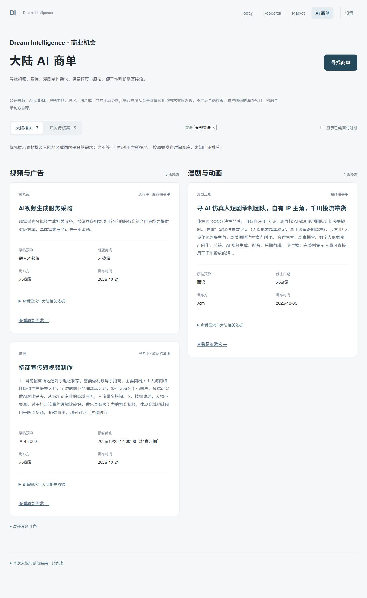

# 塔猴 / 猪八戒来源扩展验证 — 2026-10-24

目标：扩充大陆相关 AI 视频、图片、漫剧内容制作委托来源。没有扩展到软件开发、自动投标、报名或外部消息发送。

## 实际可用范围

| 来源 | 发现方式 | 真实采集结果 |
|---|---|---|
| 塔猴 | [公开商单列表](https://www.tahou.com/earns/all)及详情，每次最多 10 条 | 核对 9 条、保存 9 条；其中 2 条仍可报名、7 条报名截止已过或已停止招募 |
| 猪八戒 | [公开 AI 视频详情](https://www.zbj.com/xq/mFH6Vil9ALqQ7GFo.html)及它直接列出的相似需求，不递归扩展 | 核对 7 条、保留 3 条 AI 视频制作需求，原站均显示进行中 |

猪八戒的公开搜索请求返回安全验证跳转，音视频/AI 分类列表在本机返回没有需求卡片的页面壳，浏览器访问音视频入口也失败。没有跟随安全验证、解决挑战、使用账号会话、冒充搜索引擎或将搜索缓存当成今天的需求。当前只通过确实可读的详情及相似需求有限发现，不是全站关键词搜索。覆盖范围写入接口和页面，来源入口失效会明确失败。

## 两次真实页面采集

- Run 3：四来源均 OK，保留 20 条；新增 12、更新原有 8 条。新增来源为塔猴 9 条、猪八戒 3 条。
- 浏览器核对发现歌曲 MV 在缺少正文“视频”字样时被错误归为图片，已改用原站明确的“AI短视频 / 视频交付物”标签参与分类，并增加回归测试。已定标、工作中、已结算统一标记为停止招募。
- Run 4：2026-10-24 21:34:38–21:34:58 Asia/Shanghai，四来源均 OK，新增 0、更新已有 20 条，记录总数保持 20。MV 已正确归入视频区。
- 全库分布：AigcSDM 1、漫剧工场 7、塔猴 9、猪八戒 3；跨平台相似需求未合并，不声称为 20 个独立交易项目。
- 默认大陆相关、未过期且未关闭的线索 7 条：塔猴 2、猪八戒 3、AigcSDM 1、漫剧工场 1；归属待核实中默认显示 5 条，另 1 条过期隐藏。
- 发布时间使用详情绝对日期。猪八戒发现入口虽然本次重新读取，原始发布日期仍保留为 2026-09-17；没有把“今日发布”改写为今天。相似需求推荐卡的 `￥0` 未用作预算，详情“需人才报价”原样保留。
- 塔猴报名截止精确到北京时间时分秒，交付截止单列；不会用更晚的交付日延长报名资格。
- 不将塔猴结构化信息中的平台 `hiringOrganization` 当成真正发布方。实际雇主未公开时保持未披露。服务地区 CN 只作为原文线索；猪八戒采用需求地区，不采用人才所在地/页脚城市。

原帖抽样：

- [塔猴：招商宣传短视频制作](https://www.tahou.com/earn/220633831788337157)：￥48,000；发布 2026-10-21；报名截止 2026-10-28 14:00:00；交付截止 2026-11-05 00:00:00。
- [塔猴：唯美歌曲 MV](https://www.tahou.com/earn/220562243537688581)：￥24,000；发布 2026-10-20；报名截止 2026-10-30 14:00:00。
- [猪八戒：AI视频生成服务采购](https://www.zbj.com/xq/6PXl0mx4ABOWdoxV.html)：详情预算为需人才报价；发布日期 2026-10-21；原站进行中。

## 验证和边界

- 后端完整回归 285 passed / 0 failed；本次增加 9 个市场适配测试，包含 MV 标签、关闭状态、报名小时边界、公开链接范围、软件需求排除、缺失日期/字段以及原帖地区与页脚地区隔离。
- 前端完整回归 46 passed / 0 failed；新增 2 个测试覆盖来源筛选和有限发现说明，以及报名/交付截止与原站状态。
- TypeScript 检查 / Vite 构建成功。
- 现网 GET health、today、commissions 均 HTTP 200；GET 不增加采集记录。
- SQLite 外键检查通过；URL 唯一，重复运行无重复记录。
- 新来源采集前后原业务表数量一致：items 15453、analysis 328、research_plans 7、research_runs 25、research_videos 31、notification_deliveries 18、post_notifications 2。
- 备份：`data/dsih.pre-commission-sources-20261024T133129.bak`。
- 只重载 API 以加载修正；没有修改或重启 Scheduler，没有触发既有一次性业务 Job，没有发送飞书。
- 没有 LLM/视觉模型调用或 DeepSeek MCP 委派；没有新增第三方依赖或账号凭据。
- 浏览器实测可按塔猴/猪八戒/全部来源切换，最后恢复全部来源；保持区域与折叠显示。用户视觉和商业线索质量验收仍待进行。

