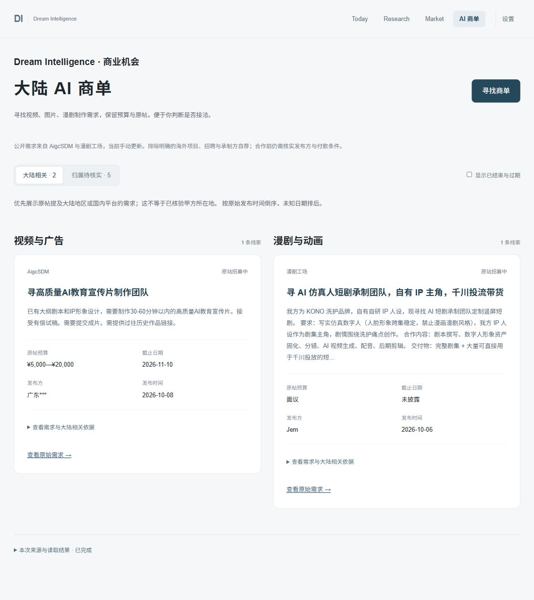

# AI 制作商单验证 — 2026-10-24

范围：大陆相关 AI 视频、图片、漫剧制作需求；不含软件开发或咨询业务。

## 实际采集

从 `/commissions` 的「寻找商单」按钮发起真实采集，共两次。

1. 第一次：AigcSDM 成功，取得并新增 1 条；漫剧工场直连超时，报告 PARTIAL。成功资料保留，未把网络故障当作没有需求。
2. 针对固定来源采用本机已有无凭据系统代理，保留证书校验及固定域名/路径限制。再次从页面发起：AigcSDM 核对 1 条、保留 1 条；漫剧工场核对 10 条、保留 7 条。两个来源均 OK，总体 COMPLETED。
3. 第二次新增 7 条、更新已有 1 条，最终 8 条来源记录。AigcSDM 同一 URL 没有重复新增。跨平台的相似需求未合并，不声称为 8 个独立商单。
4. 大陆相关原文线索 2 条；大陆归属待核实 6 条，其中 1 条截止日为 2026-10-18，默认隐藏。默认筛选显示「大陆相关 · 2」「归属待核实 · 5」。
5. 类型：视频与广告 2 条，漫剧与动画 6 条；本次没有取得图片制作需求，未生成占位商单。

抽样核对：

| 原始来源 | 需求 | 原帖字段 |
|---|---|---|
| [AigcSDM](https://square.aigcsdm.com/demands/98) | AI 教育宣传片制作团队 | ¥5,000—¥20,000；截止 2026-11-10；发布 2026-10-08；公开发布方「广东***」 |
| [漫剧工场](https://www.manjugongchang.com/demand/357) | AI 仿真人短剧承制团队、千川投流带货 | 面议；未披露截止日；发布 2026-10-06；发布方 Jem；原文提及抖音/千川，实际所在地未核验 |

“大陆相关”是原文证据归类，不是甲方资质、付款能力、所在地或商单真实性认证。

## 回归与隔离

- 后端完整测试：276 passed，0 failed；其中新增商单测试 13 个，覆盖字段缺失、原始日期、地区依据、供需过滤、固定地址限制、代理凭据拒绝、来源失败隔离、重复更新、读取无副作用等。
- 前端测试：44 passed，0 failed；其中新增商单测试 5 个，覆盖地区/过期筛选、来源证据、缺失字段、折叠区域、网络故障提示及 GET/POST 分离。主导航路由回归包含 `/commissions`。
- TypeScript 检查 / Vite 构建成功。
- 现网只读 `/api/v1/health`、`/api/v1/today`、`/api/v1/commissions` 均 HTTP 200。读取商单前后 collection 数量不变。
- SQLite `PRAGMA foreign_key_check` 无异常。
- 备份：`data/dsih.pre-commissions-20261024T130234.bak`，新增表之前完成。
- 本次采集前后原业务表计数一致：items 15418、analysis 328、research_plans 7、research_runs 25、research_videos 31、notification_deliveries 18、post_notifications 2。
- 仅重新加载 API 服务；未重启 Scheduler、添加定时 Job、修改既有任务频率或触发旧业务 Job。
- 没有调用 LLM/视觉模型或 DeepSeek MCP；没有飞书发送、投标、发布评论、解锁联系方式或登录操作。

## 浏览器验收

实际点击采集、切换待核实分区、勾选已结束与过期后看到过期标记，再恢复默认视图。预算、日期、原始链接与上表一致。区域保持两列并保留留白，每个区域先显示两条，更多结果折叠。

代码、回归、真实采集、SQLite 和浏览器交互验证通过；用户对视觉效果与线索实用性的验收待进行。
